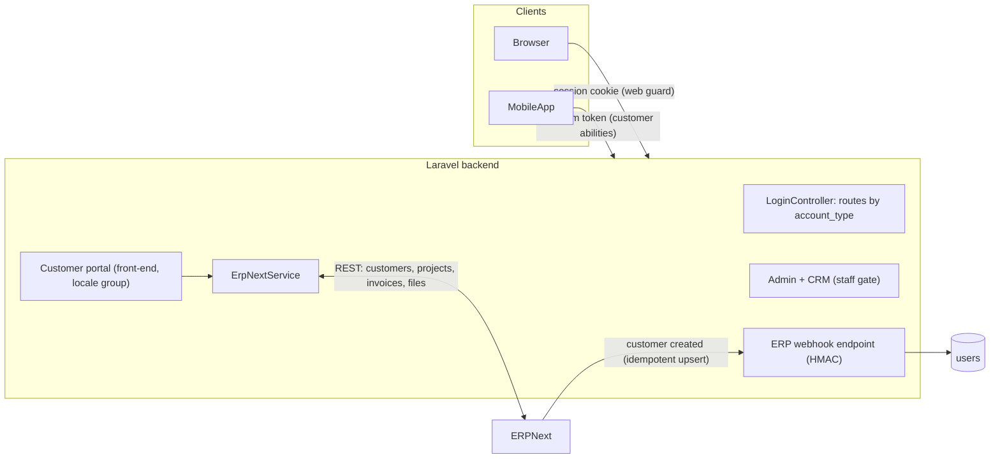
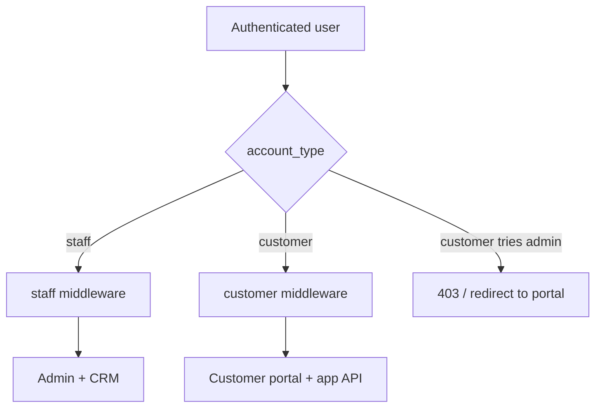
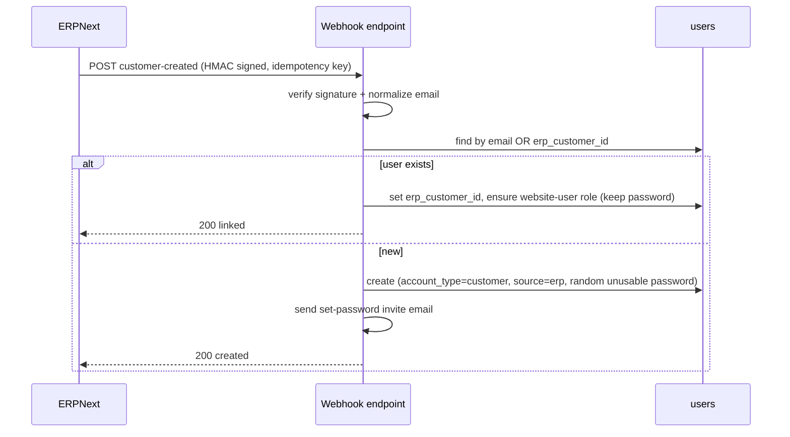
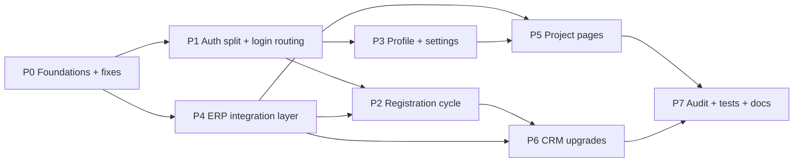
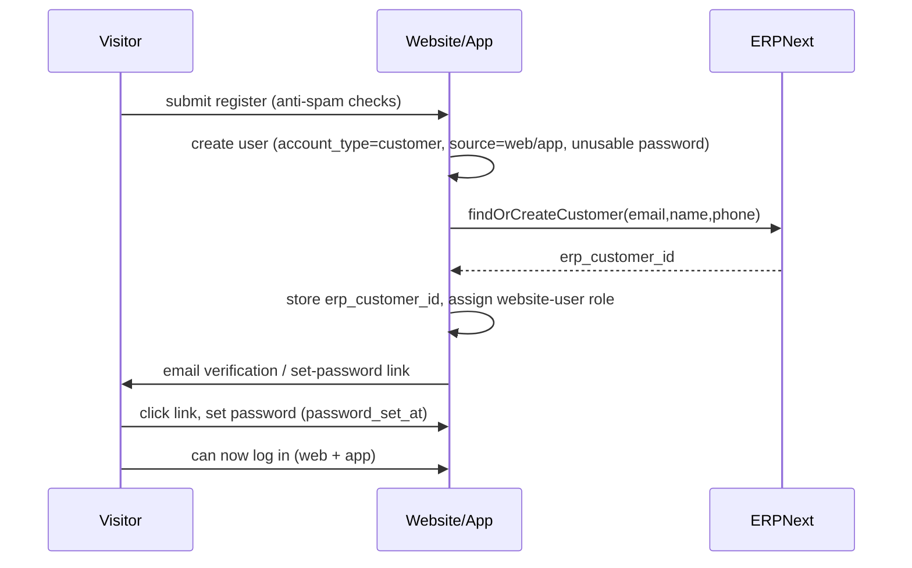

# Master Plan: Customer Portal + ERPNext Integration + CRM Upgrade

> Deep-analysis master plan for SmartVision UAE (SVEC). This is a planning document only.
> It covers the full scope discussed: users/login/roles/permissions upgrade, customer
> front-end login, profile + profile settings, registration cycle, ERPNext integration,
> CRM dashboard upgrade, CRM customers list with email actions, and the customer
> project/contract/payments pages.

---

## 0. How to use this document

- Each of the nine requested items has its own section (§7.1 - §7.9) with: goal, current-state
  analysis, design, backend work, frontend work, data model, step-by-step tasks, acceptance
  criteria, and risks.
- The phased roadmap (§6) sequences the work and shows dependencies.
- Sections §1 - §5 are the shared foundation (analysis, decisions, architecture, identity model,
  data model) that the nine items build on.
- File references point at the real code that will change.

---

## 1. Current-state analysis (what exists today)

### 1.1 Identity & auth
- Single auth guard `web`, single provider -> `App\Models\User` ([config/auth.php](../../config/auth.php) lines 38-66). No customer guard, no `Customer` model, no customer table.
- `users` table is minimal: `name`, `email` (unique), `email_verified_at`, `password`, remember token, timestamps ([database/migrations/2014_10_12_000000_create_users_table.php](../../database/migrations/2014_10_12_000000_create_users_table.php)).
- `User` model has NO `SoftDeletes` -> staff users are hard-deleted ([app/Models/User.php](../../app/Models/User.php)).
- Login is a front-end (localized) page but **redirects everyone to `route('Admin')`** ([app/Http/Controllers/LoginController.php](../../app/Http/Controllers/LoginController.php) line 116). Built for staff only.

### 1.2 Roles & permissions (RBAC)
- `User` <-> `Role` <-> `Permission` via `user_role` and `role_permission` pivots.
- Permission slugs are `{module}-{action}`; seeded from a module->actions map in [database/seeders/RolesAndPermissionsSeeder.php](../../database/seeders/RolesAndPermissionsSeeder.php).
- Route-level enforcement in [app/Http/Middleware/CheckRoutePermission.php](../../app/Http/Middleware/CheckRoutePermission.php) via a big `routeName => permission` map. Super-admin bypasses.
- **Risk:** when a route name is not in the map, the middleware allows it through (lines 591-593). Combined with a shared users table, an authenticated customer could reach unmapped admin routes.

### 1.3 Known bugs in the existing Users CRUD ([Modules/Admin/App/Http/Controllers/UsersController.php](../../Modules/Admin/App/Http/Controllers/UsersController.php))
- `update()` validates `unique:users,id,` . `$id` (line 99) -> wrong column; **duplicate emails pass on edit**. This breaks email as a reconciliation key and must be fixed first.
- `store()` does not validate the password (can hash `null`), assigns no role.
- `destroy()` has no self-delete or super-admin protection (a `users-delete` holder can delete a super-admin).
- Uses raw `DB::select` in `User::list()` returning ALL users (would include customers once added).

### 1.4 CRM module
- CRM dashboard is an empty stub -> `return view('crm::index')` ([Modules/CRM/App/Http/Controllers/CRMController.php](../../Modules/CRM/App/Http/Controllers/CRMController.php)).
- The exact pattern we need for a customers list already exists in [Modules/CRM/App/Http/Controllers/FavouritesController.php](../../Modules/CRM/App/Http/Controllers/FavouritesController.php): index + filters + live search + show + assign/unassign agent + comments + **send-email** + **send-notification** + Excel export.
- Email logging precedent: `favourite_email_logs` / `contact_us_email_logs` tables and `FavouriteEmailLog` model + Mail classes.
- CRM routes are behind `auth` only ([Modules/CRM/routes/web.php](../../Modules/CRM/routes/web.php)) - same exposure as admin.

### 1.5 Assets already available
- `laravel/sanctum` is installed (composer) with a stub `auth:sanctum` route in [routes/api.php](../../routes/api.php) -> ready for app token auth.
- Anti-spam pattern (honeypot + time-check + throttle + reCAPTCHA v3) exists in [app/Http/Controllers/ContactController.php](../../app/Http/Controllers/ContactController.php) -> reuse for registration.
- `password_reset_tokens` table configured ([config/auth.php](../../config/auth.php) line 96) -> reuse for set-password invites.
- Session/cookie identity pattern for anonymous visitors in [app/Models/Favourite.php](../../app/Models/Favourite.php) (`getSessionId`).

---

## 2. Locked decisions

1. **Identity storage:** one shared `users` table with an `account_type` column (`staff` | `customer`). Single `web` guard for the browser; **Sanctum tokens** for the mobile app. Website and app are one backend and one account per person.
2. **Project data source of truth:** **ERPNext**. The website reads project stages/status, contract, documents, and payments **live via the ERP API and caches**, keeping only a minimal local mirror for listing/performance.
3. **Password model:** the website owns the password (customer sets it via an emailed invite / set-password link). ERP never pushes plaintext passwords. Because web + app share one account, "same password on the app" is automatic.

---

## 3. Target architecture

### 3.1 Access separation (the key security outcome)

---

## 4. Identity reconciliation model (the original ERP-duplicate problem)

Reconciliation key = **normalized email** (lowercased, trimmed) plus stored ERP ids. Both
directions are **idempotent upserts**, so order of creation never produces a duplicate.

### 4.1 The four states

| ERP has them? | Website has them? | Action |
|---|---|---|
| No | No | Create in both; website emails a set-password invite. |
| Yes (ERP first) | No | Website upsert **creates** user + stores `erp_customer_id` + invite. |
| No | Yes (self-registered) | On registration, website calls ERP find-or-create; stores `erp_customer_id`. |
| **Yes + Yes** (the reported problem) | | Match by email -> **LINK** `erp_customer_id`, ensure `website-user` role, **keep existing password**, no duplicate row. |

### 4.2 ERP -> website upsert (sequence)

### 4.3 Concurrency / safety
- DB unique constraints on `email` and `erp_customer_id` are the ultimate guard.
- Catch unique-violation and treat as "fetch existing + link" (retry-as-update).
- Accept an idempotency key from ERP so retried webhooks do not double-process.

---

## 5. Data model changes

### 5.1 `users` table (additive migration)
- `account_type` enum(`staff`,`customer`) default `staff` (indexed)
- `phone` nullable
- `is_active` boolean default true
- `preferred_locale` (2-5 chars) nullable
- `source` enum(`web`,`app`,`erp`,`admin`)
- `erp_customer_id` nullable **unique**
- `erp_user_id` nullable
- `password_set_at` timestamp nullable
- `synced_at` timestamp nullable
- `deleted_at` (soft deletes)

### 5.2 New tables
- `customer_projects` (minimal mirror for listing/perf): `id`, `user_id`, `erp_project_id` (unique), `name`, `status`, `progress_percent`, `contract_ref`, `last_synced_at`, timestamps. Detail is fetched live + cached; this table exists so the list page is fast and filterable.
- `customer_email_logs` (mirror of `favourite_email_logs`): `id`, `user_id`, `to_email`, `cc_email`, `subject`, `body`, `attachments` (json), `type` enum(`direct`,`notification`), `sent_by` (staff user id), timestamps.
- (Optional) `customer_comments` for CRM internal notes on a customer (mirror `favourite_comments`).

### 5.3 Roles/permissions data
- New role `website-user` (customer, `is_system = true`, no admin permissions).
- New permission modules in the seeder: `customers` (view, create, edit, delete, send_email) and `crm-dashboard` (view).

---

## 6. Phased roadmap

- **P0 Foundations:** users schema + soft deletes, fix Users CRUD bugs, seed `website-user` + `customers` permissions.
- **P1 Auth split:** `staff`/`customer` gate middleware, login redirect by type, Sanctum token login.
- **P2 Registration cycle:** front-end + API register, invite/verify, ERP find-or-create.
- **P3 Profile + settings:** account area controllers, profile view/edit, settings (password/locale/notifications).
- **P4 ERP layer:** config, `ErpNextService`, webhook, mirror tables, caching.
- **P5 Project pages:** list + detail (stages/status, contract, documents, payments).
- **P6 CRM upgrades:** dashboard KPIs, customers list, email actions.
- **P7 Cross-cutting:** activity logging, tests, docs.

Prerequisite chain: P0 -> P1 gate everything. P4 unblocks P2 (ERP call on register), P5, and P6 (sync status).

---

## 7. Detailed item plans

### 7.1 Resolve & upgrade Users, Login, Roles & Permissions

**Goal:** a correct, secure staff account system that can safely coexist with customer accounts.

**Current state:** see §1.1 - §1.3 (email-unique bug, no soft deletes, no delete guards, permission fall-through).

**Design / steps:**
1. Migration: add the §5.1 columns to `users`; add `SoftDeletes` to [app/Models/User.php](../../app/Models/User.php) and extend `$fillable` + `$casts`; add `isStaff()`, `isCustomer()`, and `scopeStaff/scopeCustomers`.
2. Fix [Modules/Admin/App/Http/Controllers/UsersController.php](../../Modules/Admin/App/Http/Controllers/UsersController.php):
   - `store()`: `password` = `required|min:8|confirmed`; set `account_type=staff`, `source=admin`, `password_set_at`.
   - `update()`: correct rule `unique:users,email,{id}`; optional password update.
   - `destroy()`: block self-delete and block deleting a super-admin unless the actor is a super-admin.
   - Scope `User::list()` to `account_type = staff` and non-deleted.
3. RBAC seeder: add `customers` + `crm-dashboard` permission modules and the `website-user` role (§5.3).
4. (Optional, recommended) add trashed/restore for staff users to match the rest of the app.

**Acceptance criteria:** cannot create two users with the same email (create or edit); cannot delete self or a super-admin without rights; customers never appear in the staff user list; seeding creates the new role + permissions.

**Risks:** flipping `CheckRoutePermission` to strict deny could break unmapped admin sub-routes -> mitigate by relying on the `staff` gate (§7.2) as the primary isolation and keeping staff fall-through.

---

### 7.2 Customer login to the website front

**Goal:** customers log in and land on the front-end portal, never the admin panel; staff keep going to the dashboard.

**Design / steps:**
1. Add two middleware: `EnsureStaff` and `EnsureCustomer`; register aliases `staff` / `customer` in [app/Http/Kernel.php](../../app/Http/Kernel.php).
2. Apply `staff` to the admin route group ([Modules/Admin/routes/web.php](../../Modules/Admin/routes/web.php)) and CRM route group ([Modules/CRM/routes/web.php](../../Modules/CRM/routes/web.php)).
3. Branch the redirect in [app/Http/Controllers/LoginController.php](../../app/Http/Controllers/LoginController.php): `isCustomer()` -> `route('account.dashboard')`, else `route('Admin')`.
4. Defense in depth: in [app/Http/Middleware/CheckRoutePermission.php](../../app/Http/Middleware/CheckRoutePermission.php) deny non-staff.
5. App auth: `POST /api/customer/login` issues a Sanctum token with **customer-only abilities** (e.g. `customer:read`, `customer:write`); reject non-customer accounts and inactive users.

**Acceptance criteria:** a customer hitting any `/admin` or `/crm` URL is redirected/403; staff cannot use the app customer token endpoints; login sends each type to the right home.

**Risks:** shared guard means every admin/CRM route MUST be under the `staff` gate - verify no admin route sits outside the group.

---

### 7.3 Profile page (with backend)

**Goal:** a logged-in customer can view their profile (name, email, phone, ERP link status, verification state).

**Design / steps:**
1. Controllers under `app/Http/Controllers/Account/` (e.g. `ProfileController@show`), routes inside the locale group in [routes/web.php](../../routes/web.php) under `auth` + `customer`, names `account.*`.
2. Localized Blade in the website theme (EN/AR), `resources/views/pages/account/*`.
3. Read-only profile view + link to edit/settings; show project count summary (from mirror table).

**Acceptance criteria:** profile renders in both locales; only the owner sees their data; unauthenticated -> login.

---

### 7.4 Profile settings (with backend)

**Goal:** customer edits their details and account settings.

**Design / steps:**
1. `Account\ProfileSettingsController` with `edit`, `update` (details), `updatePassword`, `updatePreferences`.
2. FormRequests with **correct** `unique:users,email,{id}`; password rule `current_password` + `min:8|confirmed`.
3. Settings: change password, `preferred_locale`, notification preferences (email/notify toggles).
4. On details change, optionally push the update to ERP via `ErpNextService` (best-effort, non-blocking).

**Acceptance criteria:** email uniqueness enforced on edit; password change requires current password; locale change persists and affects future logins.

**Risks:** email change affects the ERP reconciliation key -> if allowed, re-sync ERP link or restrict email edits.

---

### 7.5 Register page + register cycle (with backend)

**Goal:** self-registration on web and app that creates a customer, links to ERP, and verifies via email.

**Register cycle:**

**Design / steps:**
1. `app/Http/Controllers/Auth/CustomerRegisterController` (web) + `Api\CustomerAuthController@register` (app), sharing a `CustomerAuthService`/`CustomerRegistrationService`.
2. Reuse anti-spam from [app/Http/Controllers/ContactController.php](../../app/Http/Controllers/ContactController.php) (honeypot, time-check, `throttle`, reCAPTCHA v3).
3. Validation: name, email (unique), phone, consent; password optional at register (invite flow preferred).
4. Email verification / set-password via `password_reset_tokens`; a Mailable for the invite.
5. Idempotency: if email already exists, do not error - resend invite or link (matches §4).

**Acceptance criteria:** registering an existing email does not create a duplicate; ERP customer is created/linked; user cannot log in until password is set/verified; app and web use the same account.

---

### 7.6 ERPNext connection - steps & needs

**Goal:** a single service layer that talks to ERPNext for customers and project data, plus an inbound webhook.

**What ERP needs to provide (needs list):**
- Base URL + API key/secret (Frappe token auth) with least-privilege on: Customer, Project (or the doctype used), Sales Invoice / Payment Entry, File.
- A webhook (or Server Script) on Customer create/update that POSTs to the website with an HMAC signature and an idempotency key.
- Agreed field mapping: customer email/name/phone/id; project id/name/status/stages/progress; contract reference/file; invoices (amount, due date, status, paid).

**Website side - steps:**
1. Config block in [config/services.php](../../config/services.php) + `.env.example` keys: `ERPNEXT_BASE_URL`, `ERPNEXT_API_KEY`, `ERPNEXT_API_SECRET`, `ERPNEXT_WEBHOOK_SECRET`.
2. `app/Services/ErpNextService.php` (uses `Illuminate\Support\Facades\Http`): `findOrCreateCustomer()`, `getCustomerProjects($erpCustomerId)`, `getProjectDetail($erpProjectId)` (stages, contract, documents, payments), with `Cache::remember` and timeouts + error handling (never break page render).
3. Inbound webhook controller (HMAC-verified) implementing the §4.2 upsert/link.
4. Mirror sync: on webhook / on read, upsert `customer_projects` and set `last_synced_at`.
5. Idempotency + graceful unique-violation handling.

**Acceptance criteria:** service returns typed arrays with caching; webhook rejects bad signatures; creating a customer in ERP results in a linked/created website user; ERP downtime degrades gracefully (cached/empty, no 500).

**Risks:** ERP doctype/field names must be confirmed; secure document downloads must be proxied (never expose raw ERP file URLs/credentials).

---

### 7.7 Improve the CRM dashboard

**Goal:** turn the empty CRM index into a useful operational dashboard.

**Design / steps:**
1. Replace `CRMController@index` ([Modules/CRM/App/Http/Controllers/CRMController.php](../../Modules/CRM/App/Http/Controllers/CRMController.php)) with real KPIs: total/ new contacts, favourites, **registered customers**, active agents, new registrations (period), unassigned leads.
2. Simple charts (registrations over time, leads by status) reusing the analytics chart approach already in the admin.
3. Recent activity lists (latest contacts, latest customers) with quick links.
4. Gate under `crm-dashboard-view` permission (added to seeder + `CheckRoutePermission` map).

**Acceptance criteria:** dashboard shows live counts; respects permissions; links resolve to the relevant CRM lists.

---

### 7.8 CRM customers list + "send email" feature with actions

**Goal:** a CRM screen listing registered customers with the same action set as Favourites, including email.

**Design / steps (model on [Modules/CRM/App/Http/Controllers/FavouritesController.php](../../Modules/CRM/App/Http/Controllers/FavouritesController.php)):**
1. `Modules/CRM/App/Http/Controllers/CustomersController`: `index` (filters: name/email/phone/agent/date/ERP-sync status), `liveSearch`, `show`, `assignAgent`/`unassignAgent`, `storeComment`/`deleteComment`, `sendEmail`, `sendNotification`, `exportReport` (Excel).
2. `customer_email_logs` table + `CustomerEmailLog` model + a `CustomerEmail` Mailable (mirror `FavouriteEmailLog`).
3. Routes in [Modules/CRM/routes/web.php](../../Modules/CRM/routes/web.php) under `crm/customers`, names `crm-customers.*`.
4. Permissions: `customers-view/create/edit/delete/send_email` (seeder + `CheckRoutePermission` map).
5. Show page: profile, ERP link/sync status, assigned agent, comment thread, email history, project summary.

**Acceptance criteria:** list filters + live search work; agent assignment + comments persist; sending an email logs to `customer_email_logs` and actually dispatches; export downloads; every action is permission-gated.

---

### 7.9 Project page + project details (stages/status, contract, documents, payments)

**Goal:** a customer sees their projects and, per project, the stages with status, the contract, documents, and payments - sourced from ERP.

**Design / steps:**
1. Front-end (locale group, `auth` + `customer`): `Account\ProjectController@index` (list from `customer_projects` mirror, scoped to the owner) and `@show` (live detail via `ErpNextService::getProjectDetail`, cached).
2. Detail sections:
   - **Stages & status:** each stage with name, status (e.g. pending/in-progress/done), progress, dates.
   - **Contract:** reference + secure download (proxied).
   - **Documents:** list + secure download (proxied through the app; never expose ERP file URLs).
   - **Payments:** schedule / invoices with amount, due date, paid/unpaid status, totals.
3. Ownership guard: verify the project's `erp_customer_id` belongs to the authenticated user before rendering/downloading.
4. App parity: `GET /api/customer/projects` and `/api/customer/projects/{id}` return the same data as JSON (token ability `customer:read`).
5. Localized (EN/AR) views in the website theme.

**Acceptance criteria:** a customer sees only their own projects; detail shows stages/contract/documents/payments; document downloads are authorized and proxied; app endpoints return identical data; ERP errors degrade gracefully.

**Risks:** large ERP payloads -> cache + paginate; document security is the highest-risk area.

---

### 7.10 Social login - "Continue with Google" (FUTURE / not yet scheduled)

> Status: **future enhancement**, not part of the current sub-plans. Recorded here so the design
> stays consistent with the identity model (§4) and the deferred-ERP seam. Depends on P1 (auth split)
> and slots alongside P2 (registration). Optional prerequisite for the mobile app's Google sign-in.

**Goal:** let a visitor register/log in as a **customer** with a Google account, on both web and app,
without creating duplicate users and without weakening staff/customer isolation.

**Why it needs a plan (not a drop-in):** the current model assumes "the website owns the password,
set via an emailed invite" (§2.3). Google accounts have no password, so this touches the auth model,
the schema, and the §4 reconciliation logic.

**Design / steps:**
1. Install `laravel/socialite`; add a `google` block to [config/services.php](../../config/services.php) and
   `.env` keys `GOOGLE_CLIENT_ID`, `GOOGLE_CLIENT_SECRET`, `GOOGLE_REDIRECT_URI`. Register the **exact**
   authorized redirect URI in Google Cloud (must match `APP_URL`; HTTPS in production).
2. Web routes (locale group, guest): `GET /auth/google/redirect` and `GET /auth/google/callback`
   -> `Auth\SocialLoginController`.
3. Shared linking logic - extend/mirror [app/Services/CustomerRegistrationService.php](../../app/Services/CustomerRegistrationService.php)
   with `resolveOrCreateCustomerFromProvider()` that, keyed on **normalized email** + `google_id`:
   - links to an existing **customer** (no duplicate - matches §4);
   - **rejects** a Google login whose email belongs to a **staff** account;
   - creates `account_type=customer`, `source=google`, assigns `website-user` role, sets
     `email_verified_at=now()` (trust Google's verified email -> **skips** the invite/set-password step);
   - respects `is_active` (block deactivated accounts, same as `LoginController@checkuser`);
   - calls `CustomerSyncService::onCustomerRegistered($user)` (no-op now, ERP find-or-create later).
4. Add a "Continue with Google" button to [resources/views/auth/login.blade.php](../../resources/views/auth/login.blade.php)
   and the register page, with terms/consent surfaced next to it (the standard form's consent checkbox is bypassed).
5. App parity (Sanctum): `POST /api/customer/auth/google` accepts a Google **ID token**, verifies it
   server-side, runs the same linking logic, and issues a token with `customer:read`/`customer:write`
   abilities (mirrors [app/Http/Controllers/Api/CustomerAuthController.php](../../app/Http/Controllers/Api/CustomerAuthController.php)).

**Data model (additive migration):**
- `users.password` -> **nullable** (Google-only accounts have none). Original
  [create_users_table](../../database/migrations/2014_10_12_000000_create_users_table.php) has it NOT NULL.
- `source` enum += `google` (currently `web,app,erp,admin`).
- `google_id` nullable **unique** (stable provider id; email can change on Google's side). Optional
  `avatar`. If more providers are ever added, promote to a `social_accounts` table instead.

**Acceptance criteria:** Google sign-in creates or links exactly one customer (never a duplicate, never a
staff link); a Google-only user logs in every time via Google; email arrives pre-verified; deactivated
accounts are blocked; the app endpoint issues a customer-scoped Sanctum token; ERP reconciliation still
runs through the seam when it lands.

**Risks:**
- **Account linking / takeover** - only ever auto-link on a Google-**verified** email; never link to a staff row.
- **Redirect-URI mismatch** - the most common failure; the URI must match the real host exactly
  (note the current local `artisan serve` vs Apache URL differences).
- **Password-less edge cases** - forgot-password would *set* a password and convert the account to hybrid; make that intentional.
- **Consent capture** - must be shown outside the standard register form.

---

## 8. Security considerations (cross-cutting)

- **Isolation:** customers and staff share a table -> the `staff`/`customer` gates + Sanctum ability scoping are mandatory, not optional.
- **No plaintext password sync** across systems; invite/set-password flow only.
- **Webhook auth:** HMAC signature + idempotency key; reject unsigned.
- **Document access:** always verify ownership and proxy downloads; never leak ERP credentials or direct file URLs.
- **Rate limiting** on register/login (web + API) and all public POSTs.
- **Fix the email-unique bug** before relying on email as the reconciliation key.

---

## 9. Permissions to add (summary)

- Modules in seeder: `customers` (view, create, edit, delete, send_email), `crm-dashboard` (view).
- Add matching entries to the `CheckRoutePermission` route map for the new CRM routes and the `CRM` dashboard route.
- New role: `website-user` (no admin permissions).

---

## 10. Testing strategy

- **ERP upsert** (all four §4.1 states) - idempotency and linking.
- **Access isolation** - customer blocked from admin/CRM; staff blocked from customer-only API abilities.
- **Registration + set-password** cycle, including duplicate-email path.
- **Project ownership** - a customer cannot read another customer's project or documents.
- **Users CRUD** - email uniqueness on create/edit; delete guards.

---

## 11. Rollout, env & ops

- New env vars: `ERPNEXT_BASE_URL`, `ERPNEXT_API_KEY`, `ERPNEXT_API_SECRET`, `ERPNEXT_WEBHOOK_SECRET` (add to `.env.example`).
- Run `php artisan migrate` (users columns + new tables), then re-seed roles/permissions.
- After deploy: `php artisan optimize:clear`, `config:cache`, `storage:link`, clear OPcache.
- Sanctum: ensure `api` middleware + token abilities are configured; confirm `APP_URL` for invite links/emails.

---

## 12. Open questions / assumptions

- ERP doctype + exact field names for Project/Stages/Invoices/Files (needs ERP-side confirmation).
- Whether customers may change their own email (affects ERP reconciliation) - default: allow, re-sync link.
- Notification channel for the app (push?) - out of scope here unless specified.
- Building the mobile app itself is out of scope; this plan delivers the shared backend + APIs.
- **Social login (Google)** - future (§7.10); pending a decision on whether to ship it, plus a Google
  Cloud OAuth client and confirmation of the production redirect URI/host.

---

## 13. Step-by-step execution checklist

1. P0: users migration + model (soft deletes, columns) -> fix Users CRUD bugs -> seed `website-user` + `customers`/`crm-dashboard` permissions.
2. P1: `EnsureStaff`/`EnsureCustomer` middleware + aliases -> gate admin + CRM groups -> login redirect by type -> Sanctum customer login.
3. P4: ERP config + `.env.example` -> `ErpNextService` (cached) -> HMAC webhook (upsert/link) -> mirror tables.
4. P2: registration (web + API) + invite/verify -> ERP find-or-create on register.
5. P3: account profile + settings (correct email-unique, password change, locale).
6. P5: project list + detail (stages/status, contract, documents, payments) + app endpoints.
7. P6: CRM dashboard KPIs -> customers list + actions + `customer_email_logs` + export -> routes/permissions.
8. P7: activity logging on new models -> feature tests -> docs (`documents/`) + update the always-applied rule.

---

## 14. Note on work already started

A prior implementation step began Phase 0/1 edits (users migration/model, Users CRUD fixes,
staff/customer middleware, login redirect, Sanctum login scaffolding). These align with §7.1 - §7.2.
Before resuming implementation, review those changes and either keep them as the P0/P1 baseline
or revert to start clean from this master plan.
