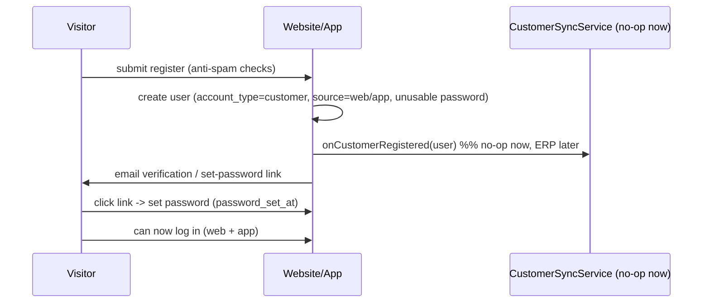

# Sub-Plan 01: Users Upgrade + Customer Registration (Internal)

> Derived from [CUSTOMER_PORTAL_MASTER_PLAN.md](CUSTOMER_PORTAL_MASTER_PLAN.md) (§7.1, §7.2, §7.5).
> Scope is deliberately narrowed to what can ship WITHOUT ERPNext. The ERP integration is
> designed-for but deferred behind a seam (§6) so it plugs in later with no rework.

---

## 1. Scope

**In scope (build now):**
1. Upgrade the internal users system: schema, soft deletes, fix the Users CRUD bugs, `account_type`, roles/permissions.
2. Auth split: staff vs customer isolation + login routing + Sanctum customer token login.
3. Customer self-registration cycle (web + app API), fully internal: create account -> email verify / set password -> login.
4. A minimal customer landing page (`account.dashboard`) so login/registration have a real destination.

**Out of scope (later sub-plans):**
- ERPNext connection (find-or-create, webhook, sync) - master plan §7.6. See seam in §6 below.
- Full profile + profile settings pages - master plan §7.3, §7.4 (only a minimal dashboard here).
- Customer project/contract/payments pages - master plan §7.9.
- CRM dashboard + CRM customers list + email actions - master plan §7.7, §7.8.

**Guiding rule:** everything that would call ERP goes through one interface (`CustomerSyncService`)
with a no-op implementation now, so registration works standalone and ERP is a drop-in later.

---

## 2. Deliverables

- Migration adding customer/identity columns + soft deletes to `users`.
- Updated `User` model (SoftDeletes, fillable/casts, `isStaff`/`isCustomer`, scopes).
- Fixed staff Users CRUD (email-unique, password rules, delete guards, staff-scoped list).
- `EnsureStaff` + `EnsureCustomer` middleware, registered and applied to admin/CRM groups.
- Login redirect by `account_type`; Sanctum `POST /api/customer/login` with customer abilities.
- Customer registration: web pages + `POST /api/customer/register`, invite/set-password, email verification.
- Minimal `account.dashboard` route + localized view.
- Seeder: `website-user` role + `customers` / `crm-dashboard` permission modules.
- `CustomerSyncService` interface + `NullCustomerSyncService` (deferred-ERP seam).

---

## 3. Data model (this sub-plan)

Additive migration on `users` (same as master plan §5.1; ERP columns are created now but stay null until the ERP sub-plan):
- `account_type` enum(`staff`,`customer`) default `staff`, indexed
- `phone` nullable, `is_active` boolean default true, `preferred_locale` nullable
- `source` enum(`web`,`app`,`erp`,`admin`) default `admin`
- `erp_customer_id` nullable unique, `erp_user_id` nullable (reserved for later)
- `password_set_at` nullable, `synced_at` nullable (reserved for later)
- `deleted_at` (soft deletes)

No `customer_projects` / `customer_email_logs` tables in this sub-plan (they belong to the ERP and CRM sub-plans).

---

## 4. Detailed steps

### Part A - Internal users / roles / permissions upgrade (master §7.1)
1. Create the additive `users` migration (§3).
2. [app/Models/User.php](../../app/Models/User.php): add `SoftDeletes`; extend `$fillable` and `$casts`; add `isStaff()`, `isCustomer()`, `scopeStaff()`, `scopeCustomers()`.
3. Fix [Modules/Admin/App/Http/Controllers/UsersController.php](../../Modules/Admin/App/Http/Controllers/UsersController.php):
   - `store()`: `password` = `required|string|min:8|confirmed`; set `account_type=staff`, `source=admin`, `password_set_at=now()`.
   - `update()`: fix to `unique:users,email,{id}`; allow optional password change.
   - `destroy()`: block deleting yourself; block deleting a super-admin unless the actor is a super-admin.
   - Scope `User::list()` to `account_type = 'staff'` and non-deleted.
4. Seeder [database/seeders/RolesAndPermissionsSeeder.php](../../database/seeders/RolesAndPermissionsSeeder.php): add `customers` (view, create, edit, delete, send_email) and `crm-dashboard` (view) modules; create `website-user` role (`is_system=true`, no admin permissions).

### Part B - Auth split + login routing (master §7.2)
1. Create `EnsureStaff` and `EnsureCustomer` middleware; register aliases `staff` / `customer` in [app/Http/Kernel.php](../../app/Http/Kernel.php).
2. Apply `staff` to the admin group ([Modules/Admin/routes/web.php](../../Modules/Admin/routes/web.php)) and CRM group ([Modules/CRM/routes/web.php](../../Modules/CRM/routes/web.php)).
3. Branch redirect in [app/Http/Controllers/LoginController.php](../../app/Http/Controllers/LoginController.php): `isCustomer()` -> `route('account.dashboard')`, else `route('Admin')`.
4. Defense in depth: deny non-staff in [app/Http/Middleware/CheckRoutePermission.php](../../app/Http/Middleware/CheckRoutePermission.php).
5. Sanctum: `app/Http/Controllers/Api/CustomerAuthController@login` issues a token with customer-only abilities (`customer:read`, `customer:write`); reject non-customer / inactive accounts. Add routes to [routes/api.php](../../routes/api.php).

### Part C - Registration cycle, internal only (master §7.5, ERP removed)

1. Web: `app/Http/Controllers/Auth/CustomerRegisterController` (`showForm`, `register`) inside the locale group in [routes/web.php](../../routes/web.php); localized Blade under `resources/views/pages/account/auth/*`.
2. API: `Api\CustomerAuthController@register` mirroring the web flow. Share logic in `app/Services/CustomerRegistrationService`.
3. Anti-spam: reuse the layered checks from [app/Http/Controllers/ContactController.php](../../app/Http/Controllers/ContactController.php) (honeypot, time-check, `throttle:5,1`, optional reCAPTCHA v3).
4. Validation: `name`, `email` (unique, normalized lowercase), `phone`, consent.
5. Password model: invite/set-password via `password_reset_tokens`; a `CustomerInviteMail` Mailable. Also support email verification (`email_verified_at`).
6. Idempotency: if the email already exists, DO NOT error - resend the invite / verification instead (forward-compatible with the ERP dedup in master §4).
7. Call `CustomerSyncService::onCustomerRegistered($user)` after create (no-op now).

### Part D - Minimal customer dashboard (login/registration destination)
1. `app/Http/Controllers/Account/DashboardController@index`, route `account.dashboard` inside the locale group under `auth` + `customer`.
2. Localized placeholder view `resources/views/pages/account/dashboard.blade.php` (welcome + verification status + logout). Full profile/projects come in later sub-plans.

---

## 5. Permissions to add
- Seeder modules: `customers` (view, create, edit, delete, send_email), `crm-dashboard` (view).
- Role: `website-user` (customer, no admin permissions).
- (CRM route-permission map entries are added in the CRM sub-plan, not here.)

---

## 6. Deferred-ERP seam (design now, implement later)

Create `app/Services/CustomerSyncService.php` as an interface (or a simple class with no-op methods)
and bind a `NullCustomerSyncService` in the container now:

- `onCustomerRegistered(User $user): void` - later: ERP find-or-create + store `erp_customer_id`.
- `pushProfileUpdate(User $user): void` - later: push changes to ERP.

Registration and profile code depend ONLY on this interface. When the ERP sub-plan lands, swap the
binding to an `ErpNextCustomerSyncService` - no changes to controllers. Columns `erp_customer_id`,
`erp_user_id`, `synced_at` already exist (§3) so nothing else migrates.

---

## 7. Acceptance criteria
- Staff Users CRUD: cannot create/edit two users with the same email; cannot delete self or a super-admin without rights; customer accounts never show in the staff list.
- A customer cannot reach any `/admin` or `/crm` URL (redirect/403); staff cannot use the customer app token endpoints.
- Login sends customers to `account.dashboard`, staff to `Admin`.
- A visitor can register (web + API), receives an invite/verification email, sets a password, and logs in on both web and app with the same account.
- Registering an existing email does not create a duplicate.
- Seeder creates the `website-user` role and the new permissions.
- ERP is untouched: `CustomerSyncService` is a no-op and registration succeeds without it.

---

## 8. Testing
- Users CRUD: email uniqueness (create + edit), delete guards.
- Isolation: customer blocked from admin/CRM; staff blocked from `customer:*` abilities.
- Registration + set-password + verification cycle, including duplicate-email path.
- Login routing by `account_type` (web) and token issuance (API).

---

## 9. Execution checklist (order)
1. Users migration + `User` model (soft deletes, columns, helpers).
2. Fix Users CRUD (email-unique, password, delete guards, staff-scoped list).
3. Seeder: `website-user` + `customers`/`crm-dashboard` permissions.
4. `EnsureStaff`/`EnsureCustomer` + aliases; gate admin + CRM groups; deny non-staff in `CheckRoutePermission`.
5. Login redirect by type; Sanctum `POST /api/customer/login`.
6. `CustomerSyncService` interface + `NullCustomerSyncService` binding.
7. Registration: web + API + `CustomerRegistrationService` + anti-spam + invite/verify mail.
8. Minimal `account.dashboard` route + view.
9. Run `php artisan migrate` + re-seed; smoke test the flows.

---

## 10. Note on work already started
A prior step began several of these edits (users migration/model, Users CRUD fixes,
`EnsureStaff`/`EnsureCustomer`, login redirect, `Api\CustomerAuthController` login, api.php routes).
Review and either keep them as this sub-plan's baseline or revert before executing from step 1.
