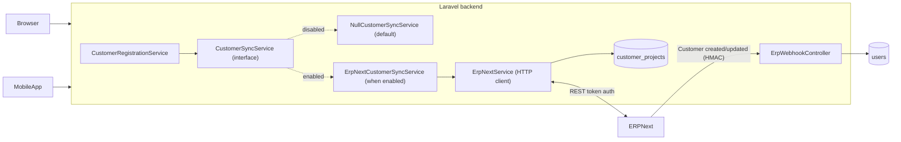
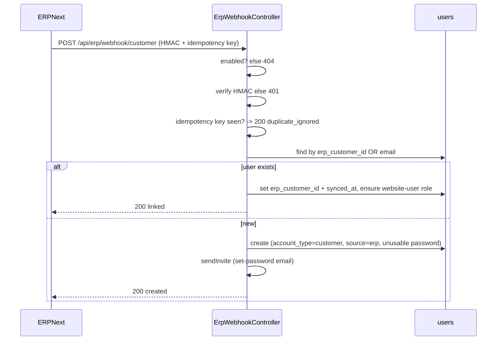
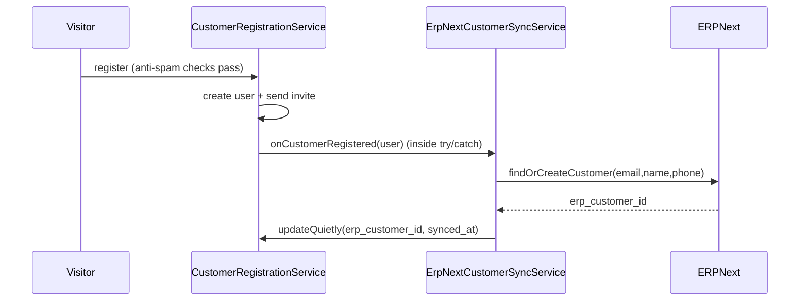
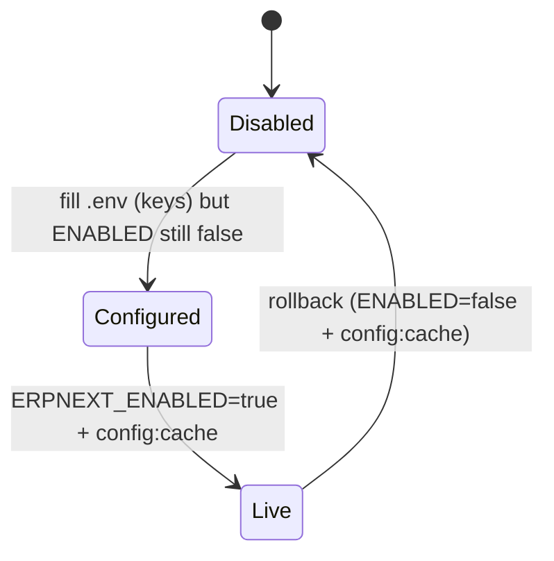

# ERPNext Integration - Full Technical Guide

> Audience: SVEC engineers (and a technical reader on the ERP side).
> Purpose: the single end-to-end reference for how the website integrates with ERPNext -
> architecture, data model, code map, the enable/disable lifecycle, security, testing,
> operations, and rollback.

Companion docs: [ERP_DEVELOPER_REQUIREMENTS.md](ERP_DEVELOPER_REQUIREMENTS.md) (what we need from ERP, before) and [ERP_POST_DELIVERY_CHECKLIST.md](ERP_POST_DELIVERY_CHECKLIST.md) (activation, after). This guide is derived from the master plan sections 4, 5.2, and 7.6 in [CUSTOMER_PORTAL_MASTER_PLAN.md](../CUSTOMER_PORTAL_MASTER_PLAN.md).

---

## 1. Design principles

1. **Disabled by default, zero live impact.** All ERP code is gated on `services.erpnext.enabled` + a configured `base_url`. Until both are set, the app binds the no-op sync service and the webhook route returns 404.
2. **Fail-open, never break the user.** Every ERP call is wrapped in `try/catch` with a timeout and returns a safe empty value. Registration/profile/login never fail because ERP is slow or down.
3. **One account per person.** Shared `users` table; reconciliation key = normalized email + `erp_customer_id`. Upserts are idempotent in both directions.
4. **Website owns the password.** ERP never sends/stores plaintext passwords; new ERP-sourced users get an emailed set-password invite.
5. **Single source of truth for field names.** All ERP doctype/field names live in one constant map (`ErpNextService::FIELD_MAP`); adapting to ERP's real schema is a one-file change.

---

## 2. Architecture



---

## 3. Identity reconciliation (master plan section 4)

The four states, all converging on a single non-duplicated user:

| ERP has them? | Website has them? | Action |
|---|---|---|
| No | No | Create in both; website emails a set-password invite. |
| Yes (ERP first) | No | Webhook creates the user + stores `erp_customer_id` + invite. |
| No | Yes (self-registered) | On register, website find-or-creates in ERP; stores `erp_customer_id`. |
| Yes + Yes | | Match by email -> link `erp_customer_id`, ensure role, keep password, no duplicate. |

### 3.1 Inbound webhook sequence (ERP -> Website)



### 3.2 Outbound sync (Website -> ERP) on registration



---

## 4. Enable/disable lifecycle



- **Disabled (today):** `NullCustomerSyncService` bound; webhook 404; no ERP calls anywhere.
- **Live:** `ErpNextCustomerSyncService` bound; webhook enforces HMAC; reads cached; writes best-effort.

The switch is decided in `AppServiceProvider::register`:

```php
$erpReady = config('services.erpnext.enabled') && config('services.erpnext.base_url');
$this->app->bind(CustomerSyncService::class,
    $erpReady ? ErpNextCustomerSyncService::class : NullCustomerSyncService::class);
```

---

## 5. Code map (what lives where)

| Concern | File |
|---|---|
| Config + flag + create defaults | `config/services.php` (`erpnext` block: flag, keys, `default_customer_group`, `default_territory`), `.env.example` |
| Binding switch | `app/Providers/AppServiceProvider.php` |
| ERP HTTP client (field map, reads/writes, cache, timeouts) | `app/Services/ErpNextService.php` |
| Sync seam interface | `app/Services/CustomerSync/CustomerSyncService.php` |
| No-op impl (default) | `app/Services/CustomerSync/NullCustomerSyncService.php` |
| Real impl (when enabled) | `app/Services/CustomerSync/ErpNextCustomerSyncService.php` |
| Inbound webhook | `app/Http/Controllers/Api/ErpWebhookController.php` |
| Webhook route | `routes/api.php` (`POST /api/erp/webhook/customer`) |
| Project mirror table | `database/migrations/2026_07_18_000000_create_customer_projects_table.php` |
| Project mirror model | `app/Models/CustomerProject.php` |
| Local identity columns | `users.erp_customer_id` (unique), `erp_user_id`, `source`, `synced_at` |

---

## 6. Data model

- `users` (existing): `erp_customer_id` (nullable, **unique**), `erp_user_id`, `source` enum incl. `erp`, `synced_at`.
- `customer_projects` (new mirror, master plan section 5.2): `user_id` (plain index, not an FK - mixed MyISAM/InnoDB engines), `erp_project_id` (unique), `name`, `status`, `progress_percent`, `contract_ref`, `last_synced_at`. Source of truth stays in ERP; this is a fast, filterable cache for the list page.

### 6.1 ERPNext specifics (confirmed against ERPNext source)

- `Customer.email_id` and `Customer.mobile_no` are **ReadOnly**, mirrored from the primary Contact (`Customer.create_primary_contact`). Setting them on create auto-generates the Contact; but filtering existing customers by `email_id` only matches those that have a primary contact. If email may live only on Contact, the ERP team should expose a Contact-based lookup (see requirements doc). Handled in `ErpNextService::findCustomerByEmail` with a documented caveat.
- `Customer` typically requires `customer_group` and `territory` on create. Provide them via `ERPNEXT_DEFAULT_CUSTOMER_GROUP` / `ERPNEXT_DEFAULT_TERRITORY`; `ErpNextService::findOrCreateCustomer` includes them only when configured.

---

## 7. Security

- **Webhook authenticity:** HMAC-SHA256 over the raw body, keyed with `ERPNEXT_WEBHOOK_SECRET`, timing-safe compared (`hash_equals`). Two encodings are accepted so either integration style works: Frappe-native `X-Frappe-Webhook-Signature` (base64, produced automatically by the Webhook doctype's "Webhook Secret") and a custom `X-ERP-Signature` (hex, from a Server Script). Missing/invalid -> 401; disabled -> 404. Route is rate-limited (`throttle:60,1`) and has no session/auth guard by design (machine-to-machine).
- **Idempotency:** `X-ERP-Idempotency-Key` cached 24h; retries return `duplicate_ignored`.
- **No plaintext passwords** cross systems; ERP-created users use an unusable random password + invite.
- **Least-privilege API user** on the ERP side (section 3 of the requirements doc).
- **Document downloads** (project phase) are proxied by the website; ERP file URLs/credentials are never exposed to the browser.
- **Outbound calls** use token auth over HTTPS with a bounded timeout.

---

## 8. Failure behavior (why users never see errors)

| Failure | Behavior |
|---|---|
| ERP unreachable/slow on register | `findOrCreateCustomer` returns null; user created locally; warning logged; linked later. |
| ERP read (projects/detail) fails | Returns `[]`/`null`; page shows cached/empty; no 500. |
| ERP write (profile push) fails | Logged; user's local change still saved. |
| Webhook processing error | Returns 500 to ERP (so ERP retries); no user-facing impact. |
| Bad webhook signature | 401; nothing processed. |
| Integration disabled | Webhook 404; no ERP code path runs. |

---

## 9. Operations / runbook

- **Enable/disable:** `.env` `ERPNEXT_ENABLED` + `php artisan config:cache`.
- **Change field mapping:** edit `FIELD_MAP`/`DOCTYPE_*` in `ErpNextService`, deploy.
- **Rotate credentials:** update `ERPNEXT_API_KEY/SECRET` (and `WEBHOOK_SECRET` in lockstep with ERP), `config:cache`.
- **Cache:** reads cached for `ERPNEXT_CACHE_TTL` seconds (default 300). Clear with `php artisan cache:clear` if needed.
- **Monitoring:** grep `storage/logs/laravel.log` for `ERPNext` / `ErpNextCustomerSync` / `ERP webhook`.
- **Rollback:** set `ERPNEXT_ENABLED=false`, `config:cache` - instant revert to no-op; data preserved.

---

## 10. Testing

- With the flag off, the existing suite is unaffected (binding = no-op, webhook 404).
- Recommended feature tests when enabling (mirror the CRM suite style):
  - Webhook: valid signature creates/links; bad signature -> 401; disabled -> 404; idempotency-key replay -> no duplicate.
  - Register-with-ERP (mock `ErpNextService`): `erp_customer_id` persisted; ERP failure still lets registration succeed.
- Manual webhook signature helper: see section 5 of the post-delivery checklist.

---

## 11. Scope boundary

In scope here (built, inert): config/flag, `ErpNextService`, real sync impl, webhook + route, mirror table/model, docs.

Out of scope (later, master plan section 7.9 / P5): the customer-facing **project list + detail pages** (stages, contract, documents, payments UI) and the read-time population of `customer_projects`. The service methods (`getCustomerProjects`, `getProjectDetail`) are already present for that phase to consume.
